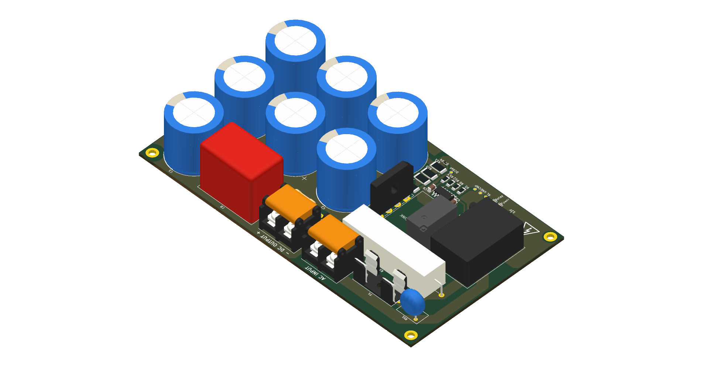
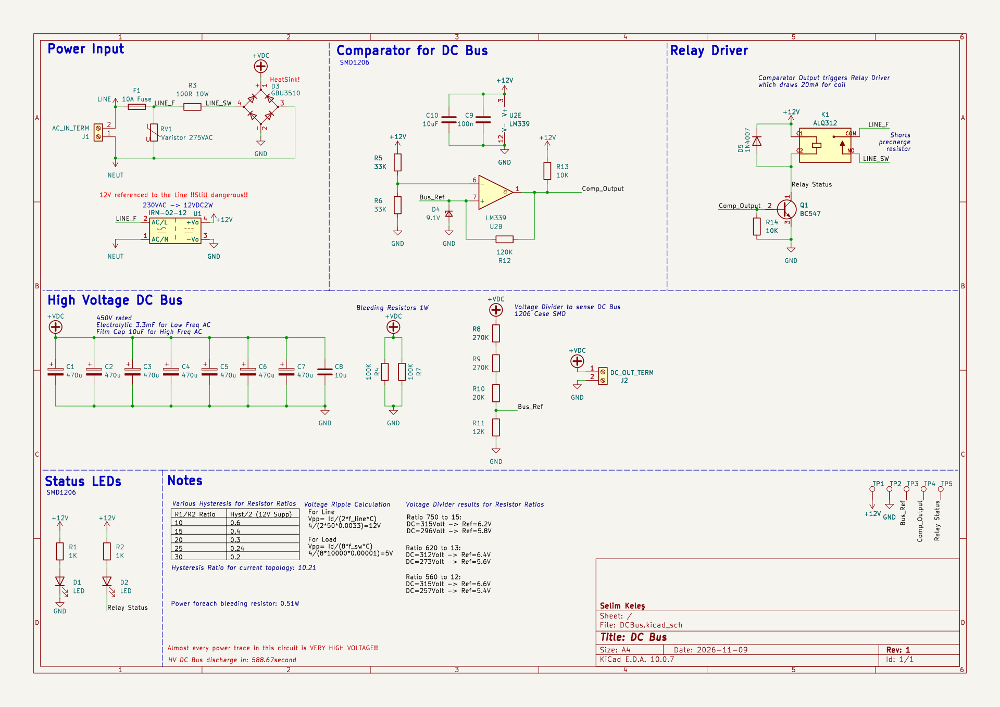

# DC Bus

Single-phase 230 V AC, 50 Hz input rectified to a 320 V DC bus.

## Features

- 230 V AC / 50 Hz single-phase input
- 320 V DC bus
- Bulk capacitors rated for 5 A current ripple with less than 20 V ripple at 50 Hz
- Precharge circuit to limit inrush current
- Bleeder resistor to discharge the bulk capacitors in under 5 minutes after power-off

## Board



## Schematic



The generated PDF is available at [output/schematic.pdf](output/schematic.pdf).

## Project Files

- `DCBus.kicad_pro` - KiCad project
- `DCBus.kicad_sch` - schematic
- `DCBus.kicad_pcb` - PCB layout
- `output/` - generated board and schematic images
- `output/gerbers/` - fabrication Gerber and drill files
- `output/erc.*`, `output/drc.*` - ERC and DRC reports
- `bom/ibom.html` - interactive bill of materials

## Design Checks

Latest local check results:

| Check | Errors | Warnings | Excluded | Unconnected |
| ----- | ------ | -------- | -------- | ----------- |
| ERC   | 0      | 3        | 6        | -           |
| DRC   | 8      | 0        | 0        | 0           |

Reports: [ERC JSON](output/erc.json), [ERC report](output/erc.rpt),
[DRC JSON](output/drc.json), [DRC report](output/drc.rpt), and
[summary](output/check-summary.md).

## Generation

Board render:

```sh
kicad-cli pcb render --output output/board.png --rotate '-45,0,135' --width 1920 --height 1080 DCBus.kicad_pcb
```

Schematic PDF:

```sh
kicad-cli sch export pdf -o output/schematic.pdf DCBus.kicad_sch
```

Gerbers and drill files:

```sh
kicad-cli pcb export gerbers --layers F.Cu,B.Cu,F.Paste,B.Paste,F.Silkscreen,B.Silkscreen,F.Mask,B.Mask,Edge.Cuts -o output/gerbers DCBus.kicad_pcb
kicad-cli pcb export drill --generate-report --report-path output/gerbers/DCBus-drill.rpt -o output/gerbers DCBus.kicad_pcb
```

Design checks:

```sh
kicad-cli sch erc --format json --severity-all -o output/erc.json DCBus.kicad_sch
kicad-cli pcb drc --format json --severity-all -o output/drc.json DCBus.kicad_pcb
python3 scripts/summarize_checks.py
```

## Continuous Integration

The GitHub Actions workflow runs on every commit to the `master` branch and regenerates:

- `output/schematic.pdf`
- `output/board.png`
- `output/gerbers/` and `output/DCBus-gerbers.zip`
- `output/erc.json`, `output/erc.rpt`, `output/drc.json`, `output/drc.rpt`
- `output/check-summary.md`

All files are published as workflow artifacts. The workflow also creates a GitHub
Release for each `master` build and attaches `output/DCBus-gerbers.zip` to it. It
uses the official `kicad/kicad:10.0.8-full` Docker image.
